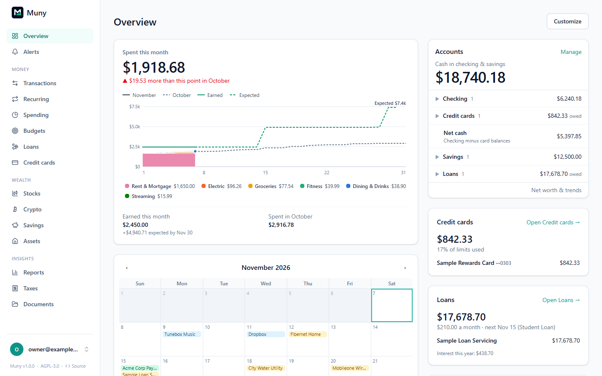
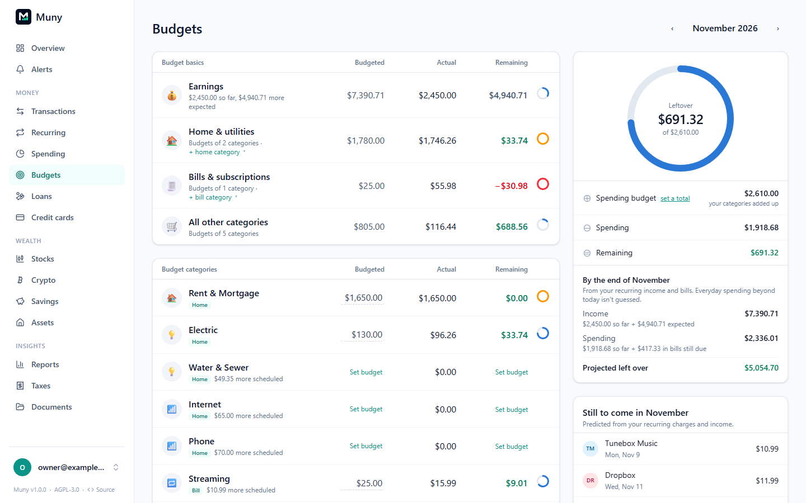
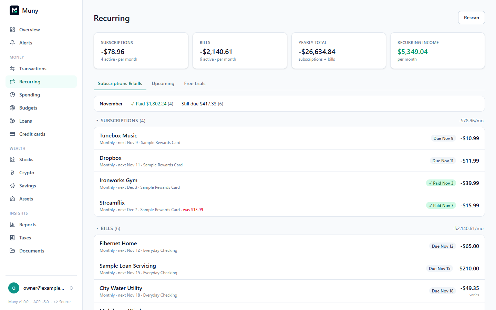
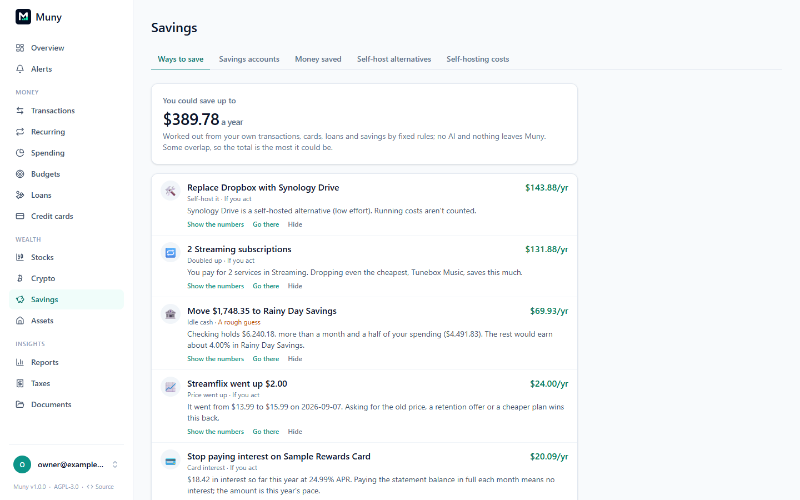
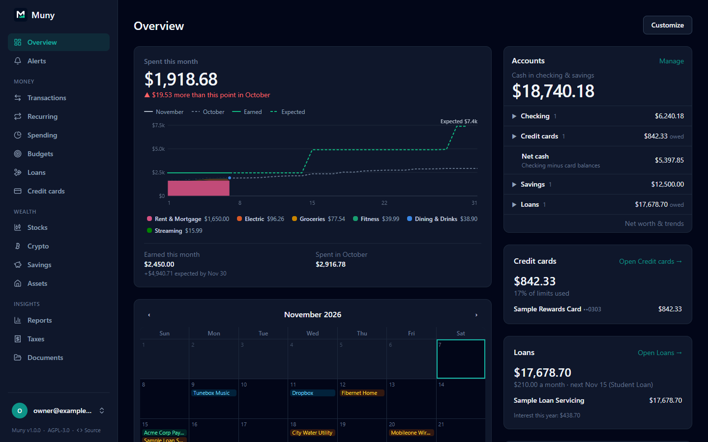

# Muny

**Self-hosted personal finance and subscription manager, built for AI agents to use.**

Muny tracks your accounts, transactions, budgets, recurring bills and subscriptions. It runs in one container on your own hardware, so your financial data stays on your machine. It also gives AI agents a scoped, permissioned way to read your data. They can then help you find savings, including subscriptions you could replace with self-hosted or DIY alternatives.



## Quick start

```sh
mkdir -p muny/data && cd muny
umask 077; printf "MUNY_SECRET_KEY=%s\n" "$(openssl rand -base64 32)" > .env
docker run -d --name muny --restart unless-stopped --user "$(id -u):$(id -g)" \
  -p 8420:8420 --env-file .env -v "$PWD/data:/data" ghcr.io/mikedmor/muny:1
```

Open `http://localhost:8420` and create your account. Add `-e MUNY_DEMO=true` to start with a made-up household to explore. Images run on amd64 and arm64; see [Install](guides/install.md) for Docker Compose, Synology and Unraid. What's new is in the [changelog](CHANGELOG.md).

## Why

Commercial tools like Rocket Money work well, but they cost a monthly subscription and hold all your financial data on someone else's servers. Muny aims to:

1. **Match the core feature set** of commercial subscription and budget trackers.
2. **Keep the data yours.** It is self-hosted, uses SQLite, has no telemetry, and you can export everything.
3. **Be AI-native.** It includes an MCP server and REST API so agents (Claude, local LLMs, etc.) can analyze spending and suggest savings.
4. **Track the DIY path.** It records which subscriptions could be replaced with self-hosted or home-built tools and what that would actually save.

## A look around

| Budgets                                                                                                                                           | Recurring bills and subscriptions                                                                       |
| ------------------------------------------------------------------------------------------------------------------------------------------------- | ------------------------------------------------------------------------------------------------------- |
|                      |  |
| **Ways to save**                                                                                                                                  | **Dark mode**                                                                                           |
|  |                                            |

Screenshots use the built-in demo household; every name and number in them is made up.

## Documentation

Guides for installing and using Muny are in [guides/](guides/README.md):

- [Install](guides/install.md) with Docker, on a Synology NAS or any Docker host
- [Secure access](guides/access.md), [Bank sync](guides/bank-sync.md) and [Importing files](guides/importing.md)
- [Budgets](guides/budgets.md), [Savings](guides/savings.md), [Loans](guides/loans.md) and [Credit cards](guides/cards.md)
- [AI assistants](guides/agents.md) over MCP, and the optional [built-in AI](guides/ai.md)
- [Stocks](guides/stocks.md), [Crypto](guides/crypto.md), [Alerts](guides/alerts.md), [Backups and export](guides/backups.md)

See also [SECURITY.md](SECURITY.md) (security model and reporting vulnerabilities) and [CONTRIBUTING.md](CONTRIBUTING.md) (development setup).

## License

[GNU AGPL-3.0](LICENSE). You're free to use, modify and self-host Muny. If you run a modified version as a network service for others, you must make your source code available to its users.
