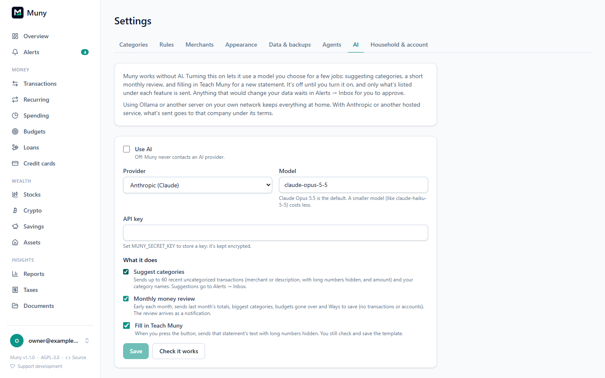

# Built-in AI (optional)

Muny works fully without AI. If you want, it can use a model you choose for three jobs. This is separate from [AI assistants](agents.md), where an assistant like Claude connects to Muny; here, Muny itself makes the call.

It's **off by default**. Until you turn it on in **Settings → AI**, Muny never contacts an AI provider.

## Choosing a provider

| Provider               | What you need                                                                                                                    | Where your data goes           |
| ---------------------- | -------------------------------------------------------------------------------------------------------------------------------- | ------------------------------ |
| **Anthropic (Claude)** | An API key from the Anthropic Console. The default model is `claude-opus-5-5`; a smaller one like `claude-haiku-5-5` costs less. | Anthropic, under its API terms |
| **OpenAI-compatible**  | The server's `/v1` address, a model name, and a key if it needs one                                                              | Whoever runs that server       |
| **Ollama**             | Ollama running on your network, e.g. `http://192.168.1.20:11434`, and a model you've pulled                                      | Stays on your own network      |

The key is stored encrypted with `MUNY_SECRET_KEY` (set it first; see [Install](install.md)), is never shown again, and never appears in logs or the audit log. **Check it works** sends a one-line test.

## What it does, and exactly what it sends

Each feature can be turned off on its own.

- **Suggest categories.** Looks at up to 60 uncategorized transactions from the last three months. Sends each one's merchant name (or bank description) and amount, plus your category names. Any run of six or more digits, like a card or account number, is replaced with `#` first. The suggestions don't change anything: they arrive in **Alerts → Inbox** from "Muny AI", one per category, for you to approve or reject, just like an assistant's. Run it from **Settings → AI → Suggest categories**.
- **Monthly money review.** In the first week of each month, Muny writes a short review of last month and leaves it as a notification. It sends only totals: income and spending for last month and the month before, your biggest categories, budgets you went over, and what [Ways to save](savings.md#ways-to-save) found. No transactions, merchants, accounts or balances. It goes to the channels you choose for **Monthly money review (AI)** under Alerts settings (in-app only unless you add one; the review includes amounts). **Write last month's review** makes one now, replacing that month's.
- **Fill in Teach Muny.** When a statement doesn't read fully and you open **Teach Muny**, **Fill in with AI** sends that statement's text (long numbers hidden) and fills in the labels it finds. Muny keeps only labels that really find a value on that statement, and you still check and save the template.

Nothing else is ever sent, and Muny never sends anything in the background except the monthly review you turned on.

## When the AI server is busy

A server on your network may be shared, asleep, or still downloading a model. With Ollama or an OpenAI-compatible server, Muny reads what the server says about why it can't answer yet, rather than giving up straight away:

| The server says                                                       | When you press a button                                               | The monthly review                             |
| --------------------------------------------------------------------- | --------------------------------------------------------------------- | ---------------------------------------------- |
| It's downloading the model                                            | Shows the progress, like "downloading to DESKTOP (42%)", and the wait | Waits it out, up to 30 minutes in all          |
| It's busy (with a place in line)                                      | Waits by itself if it's 15 seconds or less; otherwise says how long   | Waits, up to 10 minutes at a time, a few times |
| No computer is connected                                              | Says so, and to try again in about a minute                           | Tries again every minute, a few times          |
| A computer failed partway                                             | Sends it again once, 5 seconds later                                  | The same                                       |
| It doesn't have the model, or the key is wrong                        | Says so: choose another model, or enter a new key                     | Doesn't try again until you fix it             |
| Anything else that asks to wait (a `429` or `503` with `Retry-After`) | Treated like "busy"                                                   | Treated like "busy"                            |

If the monthly review still can't be written, you get one notification saying why. Muny keeps trying every hour until the 7th, and that notification disappears once the review arrives.

For a server that wants to say this: answer `503` (or `502` when a machine failed) with a `Retry-After` header and a JSON body like `{"code": "busy", "retry_after": 35, "details": {"position": 2, "eta_secs": 35}}`. The codes Muny knows are `model_downloading` (with `model`, `machine`, `percent` and `eta_secs` in `details`), `busy`, `no_machines`, `machine_failed`, `model_unavailable` (`404`) and `bad_key` (`401`). Muny goes by the code and numbers, never the `error` text.

## Costs

Hosted providers charge per use. Suggesting categories for 60 transactions and a monthly review are small requests, but check your provider's pricing. With Ollama it's free, at the speed of your own hardware.

---

[← All guides](README.md)
