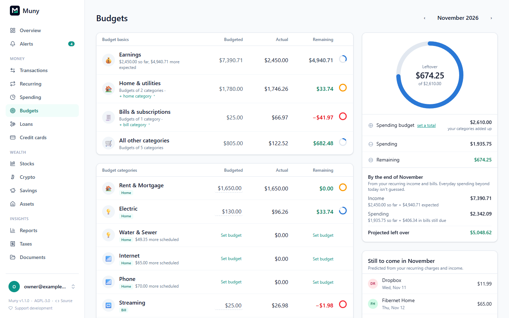

# Budgets

**Budgets** (under Money) shows one month at a time: what you planned, what you've spent, what's left, and where the month is heading. Use the arrows at the top to move between months.

## Budget basics

The four rows at the top add up for you. You never type their budgets in.

| Basic                     | Budget                                                                                | Actual                                                                                         |
| ------------------------- | ------------------------------------------------------------------------------------- | ---------------------------------------------------------------------------------------------- |
| **Earnings**              | Income received so far, plus what your recurring income should still bring this month | Money in your income categories                                                                |
| **Home & utilities**      | The budgets of your home categories added up                                          | Everything in those categories: rent or mortgage, electric, gas, water, trash, internet, phone |
| **Bills & subscriptions** | The budgets of your bill categories added up                                          | Charges from recurring bills and subscriptions, plus anything in a bill category               |
| **All other categories**  | The budgets of every other category added up                                          | Everything else you spent                                                                      |

Each charge counts in exactly one of these. Rent repeats every month, so Muny detects it as recurring, but it counts in Home & utilities, not Bills & subscriptions. Together the three spending rows always add up to your total spending.

**Which categories count where:**

- Categories marked **Home** count in Home & utilities. Rent & Mortgage, Electric, Gas & Heating, Water & Sewer, Trash, Internet and Phone are marked to start with. **+ home category** on the row adds another, and clicking a **Home** tag removes it.
- Categories marked **Bill** count in Bills & subscriptions. **+ bill category** adds another; clicking a **Bill** tag removes it.
- A category is a home cost or a bill, never both: marking it one unmarks the other.

Click any basic to open it like a category, with its months and transactions.

## Budget categories

Each row shows what you planned, what you spent and what's left, with a ring for how much is used.

- **Set or change a budget:** click the **Budgeted** amount. A change applies from that month on, so past months keep their budgets.
- **Rollover:** carries what's left (or what you overspent) into the next month.
- **Scheduled charges:** recurring charges still expected this month are shown under the category ("$65.00 more scheduled").
- Categories you spent in, or with a charge scheduled, always have a row. The rest appear when you show them all.
- **Everything else** is spending with no category. Click it to give each transaction one.

Click a category to see its months and transactions, and change any transaction's category right there. Recurring charges still expected this month are listed at the top, marked **Pending** with their expected date. They appear only on these pages, not on Transactions, until the real charge arrives.

## Summary and forecast

The side panel shows what's left this month, and what should still come in or go out before it ends:

- **Spending budget:** your category budgets added up, unless you set a total yourself. When a total you set doesn't match your categories, a bar shows how much of it they cover and what's unassigned (or how far over they go). **Follow my categories** goes back to adding them up, and **Match categories** sets the total to their sum.
- **By the end of the month:** income so far plus what's expected, and spending so far plus bills still due, giving the projected amount left over. Everyday spending beyond today isn't guessed at. Below it, **If every budget is fully used** shows what would be left if you also spent all the room remaining in your budgets. A budget you've gone over adds nothing, and an overall total, if you've set one, is the limit instead of the categories.
- **Still to come:** each recurring charge and paycheck expected for the rest of the month.

## How spending is counted

- Refunds lower the category they came back to.
- Split transactions count in each of their categories.
- Transfers between your own accounts, including card payments and moves to savings, never count.
- Hidden transactions and accounts excluded from reports never count.

## Leaving things out

- **A transaction:** hide it on Transactions. Hidden transactions don't count anywhere.
- **An account:** turn on **Exclude from reports** in the account's settings, for example for a business account.
- **A category:** under **Left out of budgets**, pick a category and click **Leave out**, or use **In budget / Not budgeted** in **Settings → Categories**. Its spending no longer counts toward budgets, the total, bills or the forecast, though it still appears in Spending and Reports. Useful for reimbursed work expenses or money you set aside on purpose. **Include** counts it again.

## Managing categories

**Settings → Categories** lists every category by group:

| Option                       | What it does                      |
| ---------------------------- | --------------------------------- |
| Click the name               | Rename it                         |
| **Move…**                    | Put it in another group           |
| **Hide**                     | Stop offering it in pickers       |
| **Home / Not home**          | Count it in Home & utilities      |
| **Bill / Not a bill**        | Count it in Bills & subscriptions |
| **In budget / Not budgeted** | Leave it out of budgets           |

On a category's own page, **Edit budget** (or the ✎ beside its name) opens everything in one dialog: name, group, icon, monthly budget and rollover, Home & utilities, Bill or subscription, Count in budgets, Budget alerts, Hide and **Delete category…**. For the icon, search about 1,900 icons by name (like "robot" or "water"), paste any emoji, or choose **Automatic** to use the one guessed from the name.

To use a category you don't have yet, type its name in any category picker and choose **+ Create "…"**, then the group it belongs in.

**Deleting a category** shows what uses it and lets you pick where it goes: its transactions, split parts, recurring charges, payee defaults and rules move to the category you choose, and its budget moves too if that category doesn't have one. Choose **Uncategorized** to leave them without a category; rules then stop setting one, and a rule that did nothing else is deleted. Categories nothing uses are marked **unused**, and **Delete unused…** removes them all at once.

## Related

- [Recurring](recurring.md): what feeds Bills & subscriptions and the forecast.
- [Alerts](alerts.md): get told when a budget reaches 80% or 100%.
- [Spending, reports and taxes](reports.md): the longer view.

---

[← All guides](README.md)
