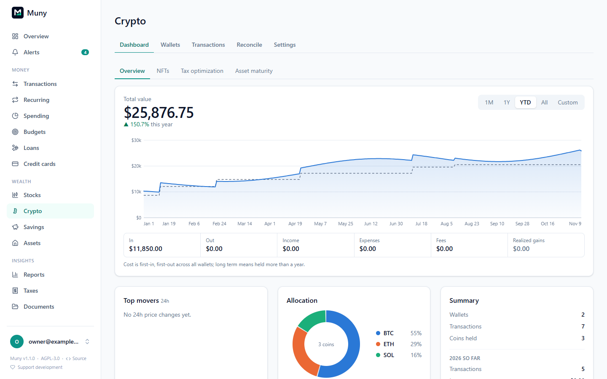

# Crypto

**Crypto** (in the menu) tracks wallets and exchanges: holdings, value over time, cost basis, gains, income, NFTs and tax reports. Muny never moves or trades crypto.

## Getting your history in

- **Koinly:** in Koinly, open **Transactions** and export them all (every year, on any plan), then drop the CSV on Muny's **Import** page or use Crypto → Wallets → **Import file**. Koinly's yearly **Transaction History** report from Tax reports works too, one file per year. Muny matches each Koinly wallet to one of yours by name, and re-importing never duplicates.
- **Wallet and exchange sync:** see below.
- **By hand:** add wallets and transactions yourself.

## Prices

Prices are **off by default**. Turn them on in **Settings → API**. Muny then fetches prices once a day, when someone opens Crypto (there's no background timer), plus whenever you press **Refresh prices**. It fills in daily history back to your first transaction.

It sends only coin ids (like `bitcoin`), never balances, addresses or wallet names. The default provider is **DefiLlama** (free, no key, years of history). **CoinGecko** is an alternative (about a year of history on its free plan; an optional free Demo key, stored encrypted, raises its limits).

### Live prices and price alerts

With **Live crypto prices** on (**Settings → API**, off by default), each coin's price on Crypto updates as it trades, from Coinbase's public price feed. No account or key is needed, and only the coins' symbols are sent. Coins Coinbase doesn't list in US dollars keep their usual daily prices. Values and totals still use the daily price, so they don't jump around while you look.

The bell on each coin sets a **price alert**: a price it rises to or falls to, or a move today or since you set it. See [Stocks](stocks.md#live-prices-and-price-alerts) for how alerts work; for coins, "today" means the last 24 hours, and alerts are checked around the clock.

## Wallet sync

Wallet sync is opt-in per wallet. On Crypto → Wallets, add a wallet with its public address, or press the link button on an existing wallet (for example one imported from Koinly). Muny stores the address encrypted and syncs it once a day when Crypto is opened, or when you press **Sync**. Synced transactions that match imported ones are skipped, and the wallet warns you if the balance on the blockchain differs from its transactions.

Pick the coin, or just paste the address and Muny recognises the format:

| Coin                                                                 | Service                                                            |
| -------------------------------------------------------------------- | ------------------------------------------------------------------ |
| Bitcoin, Litecoin                                                    | mempool.space, litecoinspace.org (no key)                          |
| Dogecoin                                                             | BlockCypher (no key)                                               |
| Ethereum, Base, Optimism, Arbitrum One, Polygon PoS, Gnosis + tokens | Blockscout (no key; an optional free key raises the limits)        |
| Cardano (ADA)                                                        | Koios (no key); a stake address covers the whole wallet            |
| Algorand (ALGO) + tokens                                             | AlgoNode (no key)                                                  |
| Stellar (XLM) + tokens                                               | Horizon (no key)                                                   |
| Cosmos Hub (ATOM)                                                    | A public REST node                                                 |
| TRON (TRX) + tokens                                                  | TronGrid (no key)                                                  |
| Siacoin (SC)                                                         | SiaScan (no key); paste several addresses separated by commas      |
| Zcash (transparent)                                                  | A Blockbook server you set in Settings → API → Wallet sync servers |

For Bitcoin, Litecoin and Dogecoin, paste the wallet's **xpub/ypub/zpub** instead of one address: Muny works out the addresses itself and looks up only those, never the key. **Never paste a seed phrase or private key** into Muny or anywhere else.

Each service sees the addresses you sync with it.

## Exchange sync

**Coinbase, Kraken, Gemini and Binance US** sync with a **read-only API key** you create on the exchange. The exchange's page in Muny shows the exact steps and permissions. The key is stored encrypted and sent only to that exchange. Muny only reads balances and history.

Closed exchanges keep their history from imports. Their page can mark what's left as **lost**, and any wallet can be **archived**: kept with its history but hidden from the wallet list and daily syncs.

## Cost basis and taxes

Crypto → Settings chooses how cost is tracked:

- **US rules (default):** one pool across your wallets through 2024, then per wallet from January 1, 2025, as the IRS requires.
- **One pool for all wallets.**

You can also choose FIFO, LIFO or HIFO. The **Taxes** page shows the year's capital gains (short and long term), income and expenses, and offers CSV reports (capital gains, Form 8949 lines, income, holdings, transaction history). You can upload exchanges' 1099-DA forms there; they're stored encrypted.

Muny's numbers are a starting point for you or your accountant, not tax advice.

## Request limits

Every call to price and sync services is counted, and Muny stays well under each service's free limits however often anyone presses refresh. Usage is shown under **Request limits** in Settings → API.

Your crypto counts toward net worth, valued at each date's price. Coins you've hidden don't count.

---

[← All guides](README.md)
