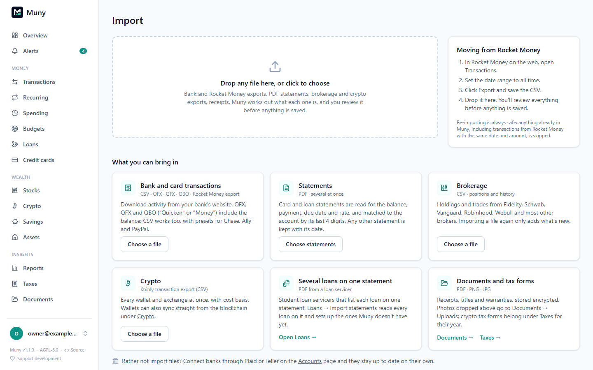

# Importing files

Everything in Muny can come from files you export yourself, whether or not you use [bank sync](bank-sync.md). **Import** (in the menu under your name, at the bottom of the sidebar) is the one place for all of them.

**Drop any file on the Import page**, or several at once, and Muny works out what each one is and opens the right importer. You always see a preview first, and nothing is saved until you confirm.

> [!NOTE]
> Re-importing is always safe. Transactions already in Muny are recognised and skipped, including ones that came from a different source with the same date and amount.

## What Muny reads

| File                          | From                                                    | What it brings in                                                                                         |
| ----------------------------- | ------------------------------------------------------- | --------------------------------------------------------------------------------------------------------- |
| **Rocket Money export** (CSV) | Rocket Money → Transactions → Export                    | Every account, transaction, category and merchant                                                         |
| **OFX, QFX or QBO**           | Your bank's download page ("Quicken" or "Money" format) | Transactions, plus the account's balance                                                                  |
| **Bank CSV**                  | Your bank's download page                               | Transactions. Chase, Ally and PayPal are recognised automatically; for anything else you pick the columns |
| **Statement PDFs**            | Your card issuer or lender                              | Balance, minimum or payment, due date, rate and, for cards, the transactions listed                       |
| **Brokerage CSV**             | Your broker's positions and history pages               | Holdings, cost basis, trades and dividends                                                                |
| **Koinly export** (CSV)       | Koinly → Transactions → Export                          | Every crypto wallet and exchange, with cost basis                                                         |
| **Photos and other PDFs**     | Anywhere                                                | Saved to **Documents → Uploads**, encrypted                                                               |

## Moving from Rocket Money

1. In Rocket Money on the web, open **Transactions**.
2. Set the date range to **all time**.
3. Click **Export** and save the CSV.
4. Drop it on Muny's Import page.

Muny lists every account in the file. For each, choose **Create new account**, an account you already have (matched by its last digits when possible), or **Don't import**. Categories Muny doesn't have yet are created as it goes.

After importing, open **Accounts** and set each account's current balance to match your bank: accounts made from a file start from a zero opening balance.

## Bank downloads

Prefer **OFX, QFX or QBO** when your bank offers them: they include the account's balance, which Muny can apply for you (**Set balance to … as of …**). CSV works too.

When Muny doesn't recognise a CSV's layout, it asks which columns hold the date, description and amount (or separate debit and credit columns), and how dates are written. It remembers your choice for files with the same columns.

## Statements

PDF statements go to the statement importer, which handles several at once and matches each to an account by the last 4 digits printed on it. For each statement you can read it into the account, just keep it under Documents with its date, or create the account from it. Each account then shows its last statement and any missing months.

See [Credit cards](cards.md#getting-the-details-in), [Loans](loans.md#statements-for-any-loan) and [Statements](rules-and-documents.md#statements) for the details. A student loan statement that covers several loans is read from the lender's card on **Loans**.

## Brokerage and crypto

- **Brokerage:** positions and account history exports from Fidelity, Schwab, Vanguard, Robinhood, Webull and most others. Where to find each one is in [Stocks](stocks.md#importing-from-your-broker).
- **Crypto:** Koinly's full transaction export, covering every year at once. See [Crypto](crypto.md#getting-your-history-in).

Both can also be opened from their own pages (**Stocks → Import**, **Crypto → Wallets → Import file**).

## After importing

- New transactions run through your [rules](rules-and-documents.md#rules), and the import summary says how many they changed.
- Recurring bills and subscriptions are detected from the new history. Review them on [Recurring](recurring.md).
- Anything left uncategorized is under **Transactions**, filtered to **Uncategorized**.

---

[← All guides](README.md)
