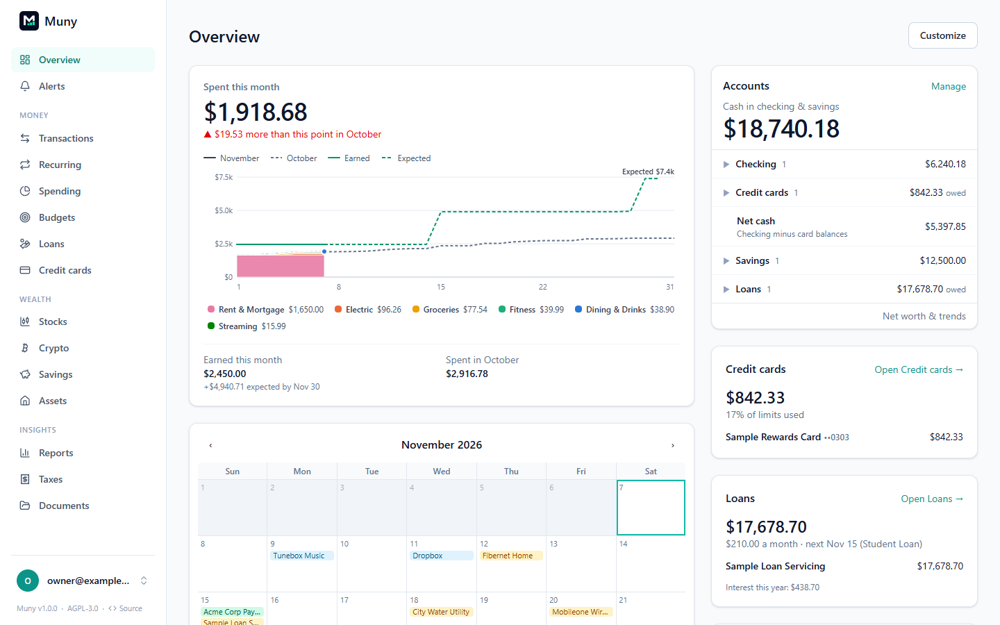

# Your Overview

The Overview shows your cards in as many columns as your screen has room for: one on a phone, two on a laptop, and three or four on wide monitors. You choose which cards appear and their priority; Muny arranges them. Each person in a household has their own.

## Customizing

Click **Customize** at the top of the page. Changes save as you make them, and **Undo** steps back through them.

- **On your Overview** lists your cards. Higher in the list means higher on the page. Drag a card by its handle to change its priority. Hovering a row also shows arrows, which work from the keyboard too. **✕** takes a card off your Overview.
- **Your page** is a live picture of the page those cards make, with your real numbers. Switch between Phone, Laptop, Wide and Ultrawide to see each arrangement. Hovering a card in the list outlines it here.
- **Columns at each size:** every size is **Automatic** or **By hand**, on its own, so your phone can keep its own order while your ultrawide is laid out exactly how you like. See below.
- **Add a card** shows everything else you could add, with previews. Click **Add**, or drag one into the list exactly where you want it.
- **✎** edits one of your own cards. On a built-in card, it opens a copy for you to change.
- **Reset to standard** goes back to the standard Overview. Your own cards stay available to add.

Charts go in the wider columns, filling whichever is shortest, and lists and balances go in the column on the right. On a wide screen, when the lists would make that column much longer than the others, your lowest-priority ones move into the shorter columns. Muny measures your cards to keep the columns level, and settles in the first moments after the page opens, so nothing moves while you're using it. On a phone, everything is one column in exactly your order. Cards with nothing to show (say, Crypto with no coins) take no space until they have something.

### Arranging columns by hand

Choose a size (Phone, Laptop, Wide or Ultrawide), then switch **Columns at this size** to **By hand**. It starts from the arrangement showing, so nothing jumps. Drag any card to any place in any column, or use the arrows on each card. Sizes arranged by hand have a dot beside their name.

- By hand, a card can go in any column, including charts in the narrow right column.
- A new card goes in the shortest column, and a card you take off goes from every size.
- Each size is stored separately, and for you alone. Other people in your household keep their own.
- Switching back to **Automatic** returns that size to your priority order. **Undo** brings the arrangement back if you change your mind.

## Making your own cards

**Customize → Create your own** opens the card editor. The card in the middle is the real thing, recalculated as you go, and the buttons above it show it at each width it could appear.

- **Blocks** (on the left) are what a card is made of: big numbers, progress bars, ranked bars, columns, lines, areas, donuts, treemaps, heat maps, scatter plots, waterfalls, lists, tables, a calendar, text, headings and dividers. Drag one onto the card, or click it to add it at the end.
- **Data** lists everything in Muny, under **Money**, **Budgets**, **Bills**, **Debt**, **Investments**, **Savings**, **Property** and **Records**. Drag a field onto a block, into a slot on the right, or onto the empty part of the card to make a new block from it. Clicking a field adds it to the selected block.
- Blocks sit on a 12-column grid. Drag a block's toolbar to move it, and its right edge to change its width.
- **Selected block** (on the right) has everything about that block: its data, dates, groupings, values, filters, and how it looks.

Colors come from your [theme](themes.md), so you never pick any, and a card looks right in every theme. If you do want a particular series to stand out, you can choose a theme role for it, like "Good" or "Chart color 3".

Custom cards are shared with everyone in your household, and each person chooses whether to put them on their own Overview.

### Changing a built-in card

Click **✎** on any built-in card. You get the card rebuilt from blocks, so you can change anything about it. When you save, your copy takes its place on your Overview, and the original stays available to add back. Copies draw from the same numbers but are built from standard blocks, so they differ slightly from the originals: for example, Recent transactions doesn't have its "find similar" button.

## Calculations

Anywhere you see a formula box, you can calculate with your data. It suggests fields and functions as you type, and tells you straight away if something's wrong. The **Formulas** tab lists every function.

| To do this                              | Write this                               |
| --------------------------------------- | ---------------------------------------- |
| Work out one total against another      | `[Spending] / [Income]`                  |
| Total only some rows                    | `sum([Spending], [Category] = "Dining")` |
| Build up a running total across a chart | `running_sum([Spending])`                |
| Compare with the row before             | `pct_change(spent)`                      |
| Show each row's share                   | `pct_of_total(spent)`                    |
| Choose between values                   | `if([Amount] < -100, "Large", "Small")`  |

A few things worth knowing:

- Money in a formula is in dollars, so `[Amount] > 100` means more than a hundred dollars. Write percentages as `10%`.
- **Values** in a block are worked out for each group of rows. **New columns** (under "New columns, order and limits") are worked out for each row first, and you can then group by them.
- Dividing by zero shows a dash rather than an error.
- Calculations are exact, with no rounding errors along the way. Money is rounded to the cent only when it's shown.

### Using different data together

**Named values** (the tab on the right) are numbers worked out once and usable anywhere on the card, written as `$name`. Each reads from any data you like, so they're how to combine things:

- `$spent`: over **Transactions**, this month, `sum([Spending])`
- `$cash`: over **Accounts**, `sum([Balance])`
- `$months`: over nothing, `$cash / $spent`

Then use them in a big number, a line across a chart, or a sentence: `At this rate, your cash lasts {{round($months, 1)}} months.`

Charts can also draw from several places at once: under **Data** on a chart, **+ Layer** adds more data on the same axis, from any dataset.

## What a card can reach

A card can read your financial data and nothing else. Passwords, sessions, bank connection credentials, API keys, wallet addresses and the contents of your documents aren't available to any card, however it was made.

A card is a description, not a program, and can't run code, change anything or send anything anywhere. That's also what makes a card safe to paste in from elsewhere.

## Cards from an AI assistant

In the card editor, **JSON or AI** gives you a prompt to copy into any assistant. It describes everything a card can be, including every dataset and function, and contains none of your financial data. Describe the card you want, as complicated as you like, then paste the assistant's answer back in. It goes on the canvas so you can check it and adjust it before saving.

---

[← All guides](README.md)
