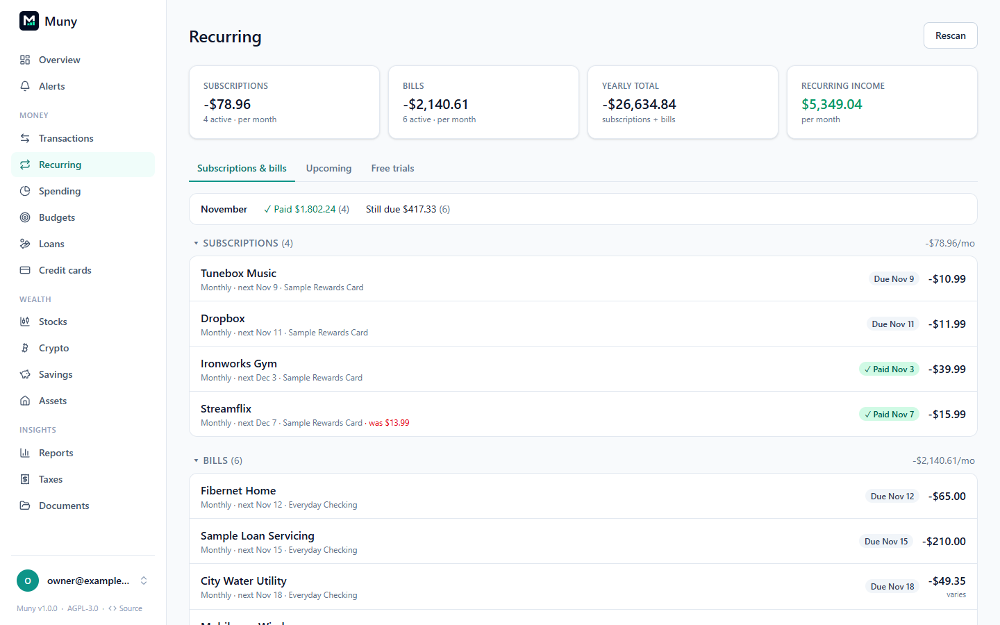

# Recurring bills and subscriptions

**Recurring** (under Money) shows everything that repeats: subscriptions, bills and income. Muny finds them on its own from your transactions, so there's nothing to set up, only to review.

## How Muny finds them

Muny looks for charges from the same merchant at a steady rhythm (weekly, every two weeks, monthly, quarterly, twice a year or yearly) and at a steady or similar amount. It checks again whenever new transactions arrive, and you can press **Rescan** at any time. A series keeps its history when a merchant renames itself or your bank changes how it describes the charge.

Each series is one of three kinds:

| Kind             | What it is                                                 | Examples                                      |
| ---------------- | ---------------------------------------------------------- | --------------------------------------------- |
| **Subscription** | A fixed price you can usually cancel online                | Streaming, software, gym, storage             |
| **Bill**         | A cost that varies, or a fixed one you can't easily cancel | Power, water, phone, insurance, loan payments |
| **Income**       | Money that arrives on a schedule                           | Paychecks, interest                           |

## Reviewing what it found

New series are marked **New**. For each one:

- **Confirm** it's real, so it counts in what's due and in your forecast.
- **Not recurring** when it isn't (several separate purchases from one shop, say). Muny won't suggest it again.

The tiles at the top add up your subscriptions and bills per month, their yearly total, and your recurring income.

## This month at a glance

Every series shows where it stands this month:

| Status                       | Meaning                                        |
| ---------------------------- | ---------------------------------------------- |
| **✓ Paid** (or **Received**) | This month's charge has arrived, with its date |
| **⏳ Pending**               | Your bank shows the charge as pending          |
| **Due**                      | Expected on the date shown                     |
| **Late**                     | The expected date has passed without a charge  |
| **Next**                     | Nothing due until a later month                |

A pending charge stands for the next one, so it isn't also listed as still to come. One that a **Count as recurring** rule puts in the series counts even when the merchant renamed it or charged a different amount.

The line above the list totals what's been paid this month, what's pending, and what's still due. **Upcoming** lists everything expected over the next 30 days, which the Overview's calendar and **Coming up** card show too, income included.

## Changing a series

Click a series to edit its name, kind, how often it repeats, its amount and category (optionally refiling its past charges), and notes. Its charges are listed underneath.

- **I cancelled it:** records the saving and marks the series cancelled. Muny confirms it when the charges stop, and alerts you if one arrives anyway.
- **Price went down:** after negotiating a bill or downgrading a plan, enter the new price to record what you're saving.
- **Price rises** are spotted on their own: the series shows **was $X**, you can get an alert, and [Ways to save](savings.md#ways-to-save) suggests asking for the old price back.

Cancelled and inactive series move to **Inactive or cancelled** at the bottom of the list.

## Keeping charges with their series when the bank renames them

Banks sometimes change what they call a merchant from one charge to the next. Left alone, a paycheck or bill then stops joining its series: it shows as late, and the month's expected income or bills count it twice. Rules prevent that, and Muny sets them up for you:

- **Your own rules come first.** If you already have a rule that's plainly about one series (it matches several of that series' charges and nothing from any other series you're still paying), Muny adds the action **Count as recurring** to it. One rule then files the bill as, say, Trash _and_ keeps it in its series.
- **Every confirmed series gets a rule.** When a series is confirmed, by you or on its own, and no rule covers it yet, Muny creates one named after it: the steady part of its bank description, money in or out, and its account. If another series shares that description (two loans with one servicer, say), the rule also gets a price range around this series’ amount so the two stay apart. Series still marked **New** don't get one until you confirm them.
- **You're in charge.** Automatic rules appear in **Settings → Rules** like any other, and each one is recorded in the audit log. Edit them freely. If you delete one, or take **Count as recurring** off a rule, Muny won't add it back. Rules for a series you mark **Not recurring** stop doing anything.

Anything a **Count as recurring** rule matches belongs to that series, whatever the merchant is called, on every scan. When a price change had split one subscription into two, and a rule puts every charge in one of them, the empty **New** copy is folded into the other. To check or change a series' rule, open the series: the panel shows which rule keeps it there, with a link to edit it. For a series without one, **Add a rule for this** (or **Add to your rule**) opens the editor already filled in.

## Adding one by hand

For something Muny didn't spot, open one of its transactions and use **Repeats** to make it recurring, choosing how often.

## Free trials

The **Free trials** tab tracks trials before they turn into charges: what it is, when it's free until, what it costs after, and optionally how to cancel. Muny reminds you before the trial ends (see [Alerts](alerts.md)), and moves it to **Past trials** afterwards.

## Related

- [Budgets](budgets.md): bills and subscriptions feed the **Bills & subscriptions** basic and the month-end forecast.
- [Savings → Money saved](savings.md#money-saved): where cancellations and lower prices are tracked.
- [Alerts](alerts.md): bills coming due, price rises and charges after you cancel.

---

[← All guides](README.md)
