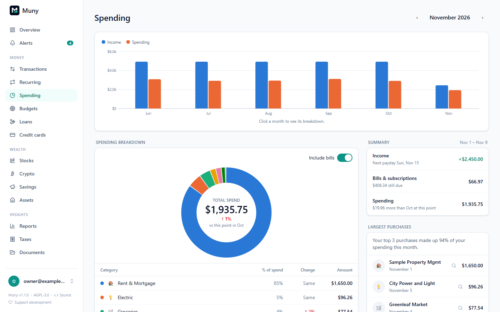
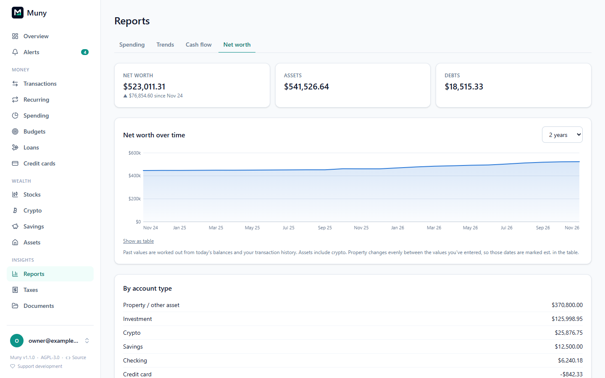
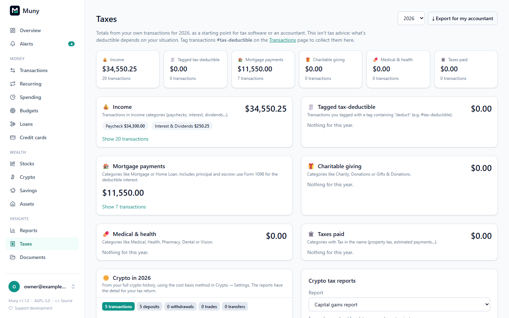

# Spending, reports and taxes

Three pages answer "where did it go?": **Spending** for the month at hand, **Reports** for longer stretches and net worth, and **Taxes** for the year.

## Spending

**Spending** (under Money) looks at one month at a time, with **Previous month** and **Next month** to move around:

- **Income and spending by month**, so you can see this month against the ones before.
- **By category**, with each category's share of spending and its change from the month before. Bills can be shown with the rest or apart from everyday spending.
- **Summary:** income, spending and what's left, plus paydays still expected and bills still due this month.
- **Largest purchases** of the month.

Click any category to open its page, with its months, budget and transactions.

## Reports

**Reports** (under Insights) covers longer periods. Choose **This month**, **Last month**, the last **3**, **6** or **12 months**, or **Year to date**.

| Report                                                  | Shows                                                                     |
| ------------------------------------------------------- | ------------------------------------------------------------------------- |
| **Income vs spending**                                  | Each month's income, spending and what you saved, for the last 12 months  |
| **Spending per month**                                  | How spending moves over the year                                          |
| **By category**, **By category group**, **By merchant** | Where the money went in the period. Click a category to see its merchants |
| **Net worth over time**                                 | Assets, debts and net worth by month, split by account type               |

Net worth includes every account that isn't excluded from reports: cash, investments, crypto at each day's price, and assets such as your home, less loans and card balances.

## Taxes

**Taxes** (under Insights) gathers a year's totals from your own transactions, as a starting point for tax software or an accountant:

| Section               | Comes from                                                                                                                            |
| --------------------- | ------------------------------------------------------------------------------------------------------------------------------------- |
| **Income**            | Your income categories                                                                                                                |
| **Deductible**        | Transactions you tag `#tax-deductible`                                                                                                |
| **Mortgage payments** | Categories like Mortgage or Home Loan. This includes principal and escrow, so use your lender's Form 1098 for the deductible interest |
| **Charitable giving** | Categories like Charity or Donations                                                                                                  |
| **Medical & health**  | Categories like Medical, Health, Pharmacy, Dental or Vision                                                                           |
| **Taxes paid**        | Categories with "Tax" in the name, such as property tax or estimated payments                                                         |

Each section says what it's based on, and lists its transactions. **Export for my accountant** downloads them all as one CSV. Crypto gains, income and Form 8949 lines appear on the same page; see [Crypto](crypto.md#cost-basis-and-taxes).

> [!NOTE]
> Muny's figures are a starting point, not tax advice. What's deductible depends on your situation.

## Leaving things out

Hidden transactions, accounts excluded from reports, and transfers between your own accounts never count in any of these pages. Refunds lower the category they came back to. See [Budgets → Leaving things out](budgets.md#leaving-things-out).

---

[← All guides](README.md)
