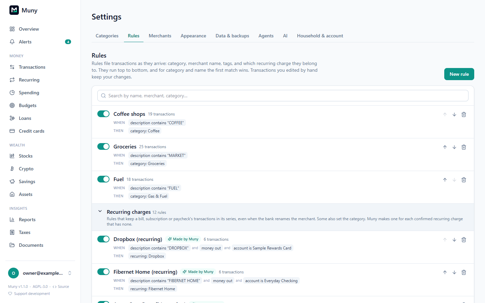
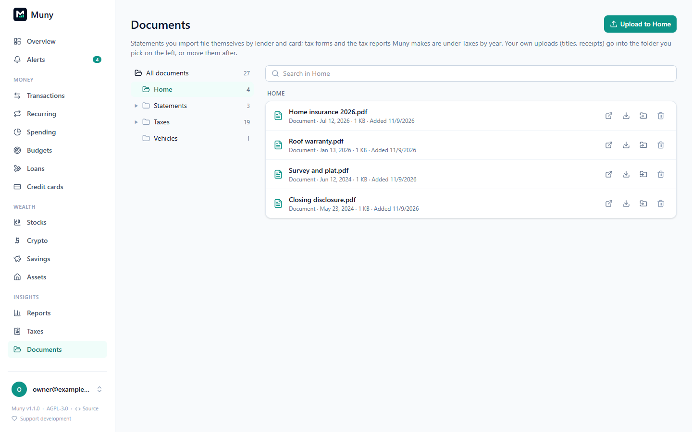

# Rules and documents

## Rules

A rule finds transactions and does something to them: sets the category, renames the merchant, adds a tag, ignores them everywhere (left out of totals and reports), or counts them as one of your [recurring](recurring.md#keeping-charges-with-their-series-when-the-bank-renames-them) bills, subscriptions or paychecks. New transactions always run your rules.

- **From a transaction:** open it. If no rule applies yet, click **Add rule** (+). If rules apply, **Rules** (→) lists them, with how many transactions each matches; click one to change it, or **Add rule** for another.
- **After changing a category** (on Transactions, or a category page, including a pending charge there): a note appears at the bottom right, "Changed category to …". Click **+ Rule** to make a rule for transactions like it, already filled in.
- **Create a rule** works in two steps. First, how it finds transactions: by name (bank description or merchant name: contains, is, starts with, ends with), amount, money in or out, and account. The matching transactions are listed as you go. **Continue**, then choose what it does, name it, and whether to change the transactions it already matches (optionally including ones you changed by hand).

All rules, their order and the full editor (several names, "any of") are in **Settings → Rules**. Each rule shows what it looks for (**When**), what it does (**Then**) and how many transactions it matches. Rules that keep a bill, subscription or paycheck in its recurring series (including ones that also set its category, and the ones **Made by Muny**) are in **Recurring charges** at the bottom; click it to see them. Search by name, merchant or category (it looks in both lists), or show only the rules that are off. Click a rule's name to edit it, use the switch to turn it on or off, and the arrows to change its order.

While you make or edit a rule, Muny warns when you already have the same rule, or another rule matches the same transactions (saying how many, and whether it files them differently), with **Edit this rule instead** to change the one you have. When rules disagree, the one higher in the list wins. **Settings → Rules** lists anything to tidy up at the top:

- **Two rules that do one job.** Often your own rule for a merchant and the rule Muny made for its recurring series. **Combine** turns them into one: your rule keeps its name and place, and gets both rules' actions, with the conditions that keep every transaction filed exactly as before. Muny only offers this when nothing would change, and checks again when you click. **Combine all** does every pair. A rule can count transactions toward several recurring series: each goes to the one on its own account. So a paycheck split across accounts needs just one rule for the employer, and Combine folds the per-account rules into yours. When combining would move a charge, the message says so: earlier deposits no rule placed joining their series (same account, same amount), or a one-off far from the usual amount, like a bonus, leaving it. Categories never change.
- **The same rule twice:** **Delete the lower one**.
- **Rules that clash:** two rules file the same transactions differently. It says how many they share and which one wins (the higher one), with buttons to edit either.

## Documents

**Insights → Documents** keeps your files in folders by where they come from:

- **Loans / lender** and **Credit cards / card:** statements you import, filed automatically.
- **Statements / account:** statements for other accounts (checking, savings…), kept with their date.
- **Taxes / year:** 1099-DA forms you added on the Taxes page, and the reports Muny makes for that year (the tax summary CSV and the crypto tax reports), made fresh when you open them.
- **Contracts / loan:** contracts you add with **Add a contract**, one folder per loan.
- **Your own folders:** **New folder**, beside the search box, makes one inside the folder you're in (`Home / Insurance` makes two levels at once). It stays even while it's empty, and an empty one you made can be deleted from inside it.

**Upload** puts files (PDF, PNG or JPEG, up to 10 MB) in the folder you're in, or **Uploads** from All documents. You can also drag files onto the file list to put them in that folder, or onto any folder on the left or in the view. That works in any folder, including a lender's or a year's. Uploading inside a loan's **Contracts** folder adds them as contracts for that loan. Move a file with the folder button; typing a new name there makes that folder too.

A contract can be read by your AI model: press **Review** beside it. See [Contract review](ai.md#contract-review).

Search by name, lender, year or folder; open, download or delete. Files are stored in Muny's database, so backups include them, and they're encrypted with `MUNY_SECRET_KEY` when it's set. The same file is only kept once.

## Statements

**Import statements** on Accounts (and on Credit cards and Loans), or the upload button on an account's row, takes one or more statement PDFs for any account. For each one Muny suggests what it is (a card or loan statement, or one it can't read) and the account, by the last 4 digits printed on it. For each statement you can:

- **Read it into the account:** card and loan statements set the balance, minimum or payment, due date and rate, as on the [Credit cards](cards.md) and [Loans](loans.md) pages. Use **Teach Muny** when a value is missing.
- **Just keep it:** store it under Documents for that account without reading it. Give the statement date (Muny suggests one when it can find it).
- **New account…:** make the account from the statement (name and type; the last 4 digits come from the statement).

Each account then shows its **last statement** date, and how many monthly statements are missing (between your first statement and now), so you can see which ones to download. A student loan statement covering several loans is read with **Import statements** on the lender's card on Loans.

---

[← All guides](README.md)
