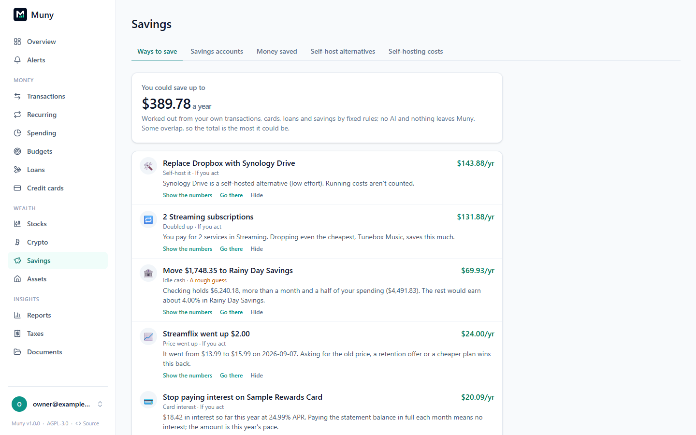

# Savings

**Savings** (in the menu, under Wealth) opens on **Ways to save**, next to the savings accounts, money saved and self-hosting tabs.

## Ways to save

Muny looks through your own data for money you could keep, and lists what it finds with the biggest yearly saving first. It uses fixed rules, not AI, and nothing leaves Muny. Each one says how it was worked out; **Show the numbers** shows the figures behind it, and **Go there** opens the page to act on it.

- **Doubled up:** two or more subscriptions in the same category (say, several streaming services). The saving is the cheapest one, since dropping any one saves at least that.
- **Charged after cancelling:** a subscription you marked cancelled that charged again.
- **Price went up:** a fixed-price subscription that rose in the last year. Asking for the old price or a cheaper plan wins it back.
- **Self-host it:** a subscription with a self-hosted or free alternative in Muny's catalog (running costs aren't counted).
- **Card interest:** interest charged on a credit card this year, at this year's pace. Paying the statement balance in full each month stops it.
- **Loan payoff order:** with two or more loans, what you'd save by sending each paid-off loan's payment to the highest-rate loan left (it uses the loans in your payoff plan).
- **Idle cash:** checking holding more than a month and a half of your spending while a savings account pays interest. This one is labelled a rough guess.

Every amount is an estimate per year. Some overlap (a subscription can be doubled up and replaceable), so the total at the top is the most it could be. **Hide** puts one away; it comes back under "you've hidden", and a new situation (like another price rise) shows again on its own. Assistants see the same list with the `get_savings_opportunities` tool.

## Savings accounts

Every account of type **Savings** gets a card showing:

- **Balance over time**, split into the money you added and the interest it earned.
- **Interest by month** for the last year, plus totals for the last 30 days, this year and the last 12 months.
- **Rate.** Banks don't report their APY through bank sync, so click **Add APY** to enter your account's advertised rate. Muny also works out the rate you actually earned over the last year: interest divided by the average balance.
- **Added per month:** the average money you put in (minus what you took out) over the last year, not counting interest.
- **Where it's heading:** what the balance would be in 1, 5 and 10 years at that rate if you keep adding the same amount each month. Change the rate or the monthly amount to try other plans. It's an estimate, since savings rates change.

Interest is any money in that's categorized **Interest & Dividends**, or that the bank describes as interest.

### Categories inside an account

Some banks split a cash account into categories but report one balance. Muny files their moves ("Vacation Deposit CASH_CATEGORY") as internal transfers, so they never count as spending or income. Under the account on **Savings**, **Set them up** (or **Edit plan**) lays it out like your bank's plan:

- The account's own cash comes first, with the amount it keeps (for example $1,000); its balance is whatever the categories don't hold.
- Then each category in order, with what it holds now, a goal, and how much it saves at most a month; Muny shows when it reaches the goal at that rate.
- The last can **save all remaining cash** instead of a goal.

How each category's amount is worked out:

- **Split the account's total by the plan** (any savings account, nothing to keep up): the main cash gets its target, then each category up to its goal in order, and the last takes the rest (or what's left stays in the main cash).
- **Follow the transfers my bank reports** (banks that post a transfer for each move): enter what each category holds now; Muny follows its moves from then on. Deposits your bank's automations put straight into a category may not say which one they went to: update that category's balance now and then.

Any savings account can have a plan: **Plan this account** under it on Savings.

## Money saved

The savings ledger records what cancelling, downgrading and negotiating have saved you, and checks it against your bank data rather than taking it on trust.

- **From Recurring:** on a subscription or bill, **I cancelled it** or **Price went down** records the saving for you (see [Recurring](recurring.md#changing-a-series)).
- **By hand:** **Record a saving** for anything else, with what it cost before and after, monthly, yearly or one-time.

Each saving is one of **Cancelled**, **Downgraded**, **Negotiated**, **Replaced (DIY)** or **Other**, and shows where it stands:

| Status                 | Meaning                                                              |
| ---------------------- | -------------------------------------------------------------------- |
| **Waiting to confirm** | Recorded, but no bill has come due yet to prove it                   |
| **✓ Confirmed**        | The charge stopped (or dropped to the new price) when it should have |
| **⚠ Still charged**    | A charge arrived after you cancelled. You get an alert too           |

The tiles at the top total what you're saving each month (confirmed, plus what's waiting), what you've saved so far, and the yearly rate. A saving that isn't linked to a bank charge can't be checked automatically, so you confirm it yourself.

## Self-host alternatives

Muny ships with a catalog of self-hosted and free alternatives to paid services: cloud storage, streaming, password managers, photo backup and more. **Subscriptions you could self-host** lists the ones you pay for that have an alternative, with a link to each project, the setup effort, and what you'd give up.

**Your switches** tracks a replacement from start to finish: **Idea → Testing → Migrated → Paid plan cancelled** (or **Abandoned**). Setting **Paid plan cancelled** records the saving and marks the subscription cancelled, so Muny can confirm the charge stops.

## Self-hosting costs

Self-hosting isn't free, so **What self-hosting costs you** keeps the running costs: power, hardware, domains, hosting or a VPS, off-site storage, and software or licenses. They're taken off your replacement savings, so the figure you see is what you really save.

The catalog is maintained by the community. If you know a good alternative it's missing, see [CONTRIBUTING.md](../CONTRIBUTING.md).

---

[← All guides](README.md)
